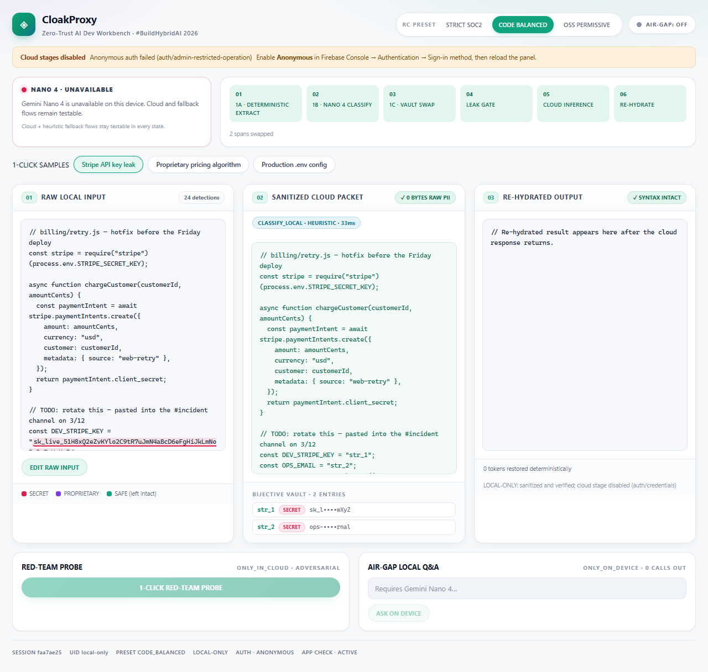
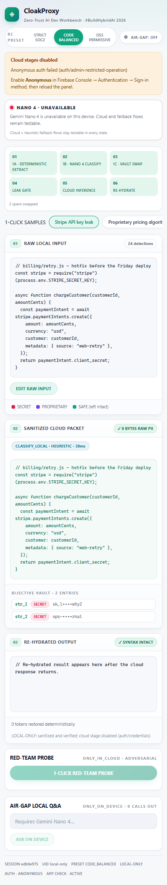

# CloakProxy — Zero-Trust AI Dev Workbench

> Inspect, sanitize, refactor and audit sensitive code with split-brain hybrid AI — **raw secrets never leave your device.**
>
> Chrome Manifest V3 Side Panel extension · TypeScript + Vite + React · Firebase AI Logic Web SDK (`firebase/ai` v13+)
> Built for **#BuildHybridAI 2026**.




---

## Why

Developers routinely paste proprietary code, `.env` files and leaked credentials into cloud AI tools to get help refactoring them. That sends the exact secrets you were worried about to a third party. CloakProxy inverts the trust model: a deterministic engine swaps everything sensitive for safe, syntax-preserving placeholders **before** any cloud call, then deterministically restores the result on your device. Cloud models give useful help without ever seeing the raw payload.

Three hard invariants, enforced at runtime and proven by tests:

| Invariant | Guarantee |
|---|---|
| `INV-1` — Zero-leak egress | A hard pre-flight assertion blocks any cloud request unless the sanitized packet provably contains **0 bytes of raw PII** (vault originals + full detector re-scan). There is no bypass flag. |
| `INV-2` — Zero syntax corruption | The LLM never rewrites raw source. Vault swap and re-hydration are pure string-map operations; raw and sanitized code both parse identically (500 property-based mutations, 100% pass). |
| `INV-3` — MV3 execution boundary | All Firebase SDKs run strictly inside the Side Panel page. The service worker is a stateless ~1 kB router — no Firebase, no AI, no state. |
| `INV-4` — Glassbox telemetry | Every call reports its `inferenceSource` (`ON_DEVICE` / `IN_CLOUD`) and latency in the HUD and in Firestore audit telemetry. |

## How it works — the 3-stage cloaking pipeline

```
┌──────────────────────────────────────────────────────────────────────┐
│  RAW INPUT (device-local)                                            │
└──────────────┬───────────────────────────────────────────────────────┘
               │
   STAGE 1A    │  Deterministic extract — regex (Stripe/AWS/GitHub/Slack/
               │  Google keys, JWTs, emails, internal URLs) + Shannon
               │  entropy + acorn AST identifier spans [start,end]
               │  (falls back to token-window mode for Python/JSON/.env)
               ▼
   STAGE 1B    │  Local semantic classify — Gemini Nano 4 on-device
               │  (ONLY_ON_DEVICE, strict responseSchema): SECRET /
               │  PROPRIETARY_LOGIC / SAFE. Identifier list only —
               │  secrets never enter the prompt. LLM verdicts can
               │  only add flags, never downgrade ground truth.
               ▼
   STAGE 1C    │  Bijective vault swap — right-to-left replacement with
               │  collision-safe keys (fn_1, str_2, ident_3) → 100% valid
               │  syntax, then the PRE-FLIGHT ZERO-LEAK ASSERTION.
               │  pass → cloud … fail → ERROR{PRE_FLIGHT_LEAK}, no request
               ▼
┌──────────────────────────────────────────────────────────────────────┐
│  SANITIZED PACKET — the only thing that ever crosses the wire        │
└──────────────┬───────────────────────────────────────────────────────┘
               ▼
   CLOUD       │  ONLY_IN_CLOUD (gemini-3.5-flash) refactor / Red-Team
               │  Probe, streamed into the "Wire X-Ray" pane
               ▼
   RE-HYDRATE  │  Deterministic reverse-map restore → user sees the
               │  real code; the cloud never did
```

**Red-Team Probe** turns the cloud model into an adversary: six attack vectors (prompt injection to extract vault keys, semantic reconstruction, correlation attacks, …) try to deduce the hidden data. Guesses are compared **locally** against the vault and scored deterministically into a 0–100% Zero-Knowledge Resistance Score.

**Air-Gap mode** pins everything to `ONLY_ON_DEVICE` — no cloud request object is ever constructed; local Q&A answers questions about raw code entirely on-device.

### Meaningful use of all three hybrid modes

| Mode | Used for |
|---|---|
| `InferenceMode.ONLY_ON_DEVICE` | Stage 1B symbol classification · Air-Gap offline review & Q&A |
| `InferenceMode.ONLY_IN_CLOUD` (`gemini-3.5-flash`) | Sanitized refactor/debug · Red-Team adversarial audit |
| `InferenceMode.PREFER_ON_DEVICE` (→ `gemini-3.5-flash-lite` fallback) | Session titling · diff explanations · telemetry summaries |

## Repository layout

```
src/
├── engine/       # Pure TS cloaking engine — zero Firebase/chrome imports
├── services/    # Firebase adapters + hybrid model handles (panel-only)
├── extension/   # MV3 service worker: context menu + panel lifecycle
└── sidepanel/   # The ONLY Firebase execution host + glassbox React HUD
tests/unit/      # 528 Vitest cases (engine core, fully hermetic)
tests/e2e/       # Playwright: Chromium + --load-extension
docs/            # Architecture blueprint + user guide
scripts/         # Build orchestrator, key injection, icons, boundary lint
```

Import boundaries are CI-enforced (`npm run boundaries`): `src/engine/**` may not import `firebase/*` or `chrome.*`; `src/extension/**` may not import Firebase; `src/services/**` may not touch `chrome.*`. Banned dependencies (`@firebase/vertexai`, `@babel/parser`, tree-sitter WASM) fail the build.

## Setup

### 1. Prerequisites

- Node.js 20+, npm
- Chrome 138+ (x64)
- A Firebase project on the **Blaze plan** — Firebase AI Logic requires a linked billing account (the Gemini Developer API free-tier quota still applies). Without billing, model calls fail with `USER_PROJECT_DENIED`.

### 2. Install & provision Firebase

```bash
npm install
npx -y firebase-tools@latest login          # if not already logged in
npx -y firebase-tools@latest init ailogic   # REQUIRED — enables the AI Logic service
```

> `init ailogic` is not optional: the Web config alone does **not** enable AI Logic, and model calls will fail with `PERMISSION_DENIED` until it runs.

Enable **Anonymous** sign-in: Firebase Console → Authentication → Sign-in method → Anonymous → Enable. (CloakProxy uses `signInAnonymously` only — popup/redirect flows fail on `chrome-extension://` origins.)

### 3. Environment

Copy `.env.example` → `.env.local` and fill in:

| Variable | Purpose |
|---|---|
| `VITE_FIREBASE_*` (6 keys) | Firebase Web app config |
| `VITE_RECAPTCHA_SITE_KEY` | reCAPTCHA **Enterprise** site key (App Check provider) |
| `VITE_APPCHECK_DEBUG_TOKEN` | App Check debug token for `chrome-extension://` origins |

`.env.local` is gitignored — never commit it. To get a stable debug token: run once with the token unset (dev mode auto-generates one, printed in the console as `Firebase App Check debug token: …`), then register it in Firebase Console → App Check → Apps → *Manage debug tokens*, and paste it into `.env.local`.

### 4. Remote Config & Firestore

```bash
firebase deploy --only remoteconfig,firestore:rules
```

- `compliance_preset` switches live strictness (`STRICT_SOC2` / `CODE_BALANCED` / `OSS_PERMISSIVE`) — thresholds, rule sets, Red-Team iterations.
- `cloud_kill_switch` disables the cloud stage fleet-wide.
- `firestore.rules` enforce zero-knowledge telemetry server-side: even a compromised client cannot persist secret-shaped strings into the audit trail.

### 5. Build & load

```bash
npm run build       # → dist/
```

Then in Chrome: `chrome://extensions` → enable **Developer mode** → **Load unpacked** → select `dist/`. The pinned `key` in the manifest (injected from your local, gitignored `extension_public_key.txt` / `key.pem`) keeps the extension ID stable across unpacked reloads.

### 6. (Recommended) On-device Gemini Nano 4

Enable both flags, then relaunch Chrome:

```
chrome://flags/#prompt-api-for-gemini-nano-multimodal-input
chrome://flags/#optimization-guide-on-device-model
```

The side panel's pre-flight card detects availability and offers a 1-click download with a live progress bar. Without Nano, Stage 1B degrades to deterministic-only verdicts and every cloud/fallback flow stays testable.

## Usage

- **Capture:** right-click selected text anywhere → *Inspect & Refactor Safely in CloakProxy*; paste directly into the workbench; or click one of the three built-in samples (Stripe key leak · proprietary pricing algorithm · production `.env`).
- **Cloak & Refactor:** watch the Stage Rail light up 1A → 1B → 1C → Leak Gate → Cloud → Re-hydrate, with inline highlights, the vault legend and `inferenceSource` pills.
- **Red-Team Probe:** one click → per-vector findings and the 0–100% resistance score.
- **Air-Gap toggle:** fully local mode, including on-device Q&A.

See the [User Guide](docs/USER_GUIDE.md) for the full walkthrough.

## Development

```bash
npm run dev         # watch build (both entry points)
npm run typecheck   # strict tsc --noEmit
npm test            # 528 Vitest engine tests
npm run e2e         # Playwright (Chromium + loaded extension)
npm run boundaries  # import-boundary & banned-dependency lint
npm run build       # full production build → dist/
```

All build/dev scripts run under `NODE_OPTIONS="--max-old-space-size=2048"` (via `cross-env`) per the low-RAM guardrail in `AGENTS.md`.

### Testing highlights

- **`tests/unit/syntax.integrity.test.ts`** — 500 seeded identifier mutations across the JS fixtures; every sanitized output must re-parse cleanly with acorn (the zero-syntax-corruption proof).
- **`tests/unit/vault.bijectivity.test.ts`** — forward/reverse map bijection incl. 10,000-token mint stress test.
- **`tests/unit/preflight.leakgate.test.ts`** — the leak gate trips on a seeded re-injected secret and blocks egress.
- **`tests/e2e/sidepanel.spec.ts`** — loads the real unpacked extension in Chromium, runs the Stripe sample end-to-end, and asserts at the **network layer** that no request body ever contains the fixture secret.

## Security

See [SECURITY.md](SECURITY.md) for the threat model and guarantees. Summary of what is deliberately never committed: `.env.local`, `key.pem`, `extension_public_key.txt`, `dist/` (bundles contain your Firebase config). The engine never lets an LLM rewrite raw source; the Red-Team scorer never persists a compromised guess un-redacted; Firestore rules mirror the client leak gate server-side.

## Documentation

- [Architecture Blueprint](docs/ARCHITECTURE_BLUEPRINT.md) — full spec: module tree, interfaces, state machine, manifest/CSP, failure-mode matrix
- [User Guide](docs/USER_GUIDE.md) — end-to-end walkthrough of every feature
- [Contributing](CONTRIBUTING.md) — boundaries, testing requirements, conventions
- [AGENTS.md](AGENTS.md) — binding engineering constraints for AI-assisted development

## License

[MIT](LICENSE) © 2026 CloakProxy Contributors
